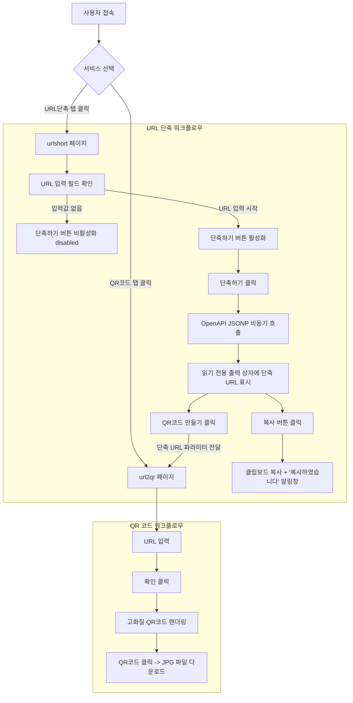

# 📋 QR & URL Studio 프로젝트 개요 및 기능 명세서

---

## 1. 프로젝트 개요 (Project Overview)

### 1.1 프로젝트 목적
본 프로젝트는 사용자가 웹 링크를 다룰 때 가장 빈번하게 사용하는 두 가지 핵심 기능인 **고화질 QR코드 생성**과 **무료 URL 단축**을 하나의 웹 애플리케이션 스위트 안에서 유기적으로 이용할 수 있도록 구축된 모던 웹 서비스입니다.

### 1.2 주요 특징
- **원클릭 서비스 상호 전환**: 상단 네비게이션 탭(`QR코드` ↔ `URL단축`)을 통해 어디서든 자유롭게 전환 가능
- **고화질 QR코드 생성 & JPG 다운로드**: 300DPI 인쇄 품질의 고해상도 QR 이미지 생성 및 다운로드
- **안전하고 신뢰할 수 있는 OpenAPI 기반 URL 단축**: `is.gd` 및 `v.gd` 공식 OpenAPI와 JSONP 통신을 결합하여 브라우저의 CORS 제약 없이 실제 유효한 단축 링크 생성
- **스마트한 기능 간 연계**: 단축된 URL을 클릭 한 번으로 QR코드로 바로 변환하는 파이프라인 제공
- **감성적이고 모던한 UI/UX**: 마우스 반응형 오로라 그라데이션, 글래스모피즘(Glassmorphism), 부드러운 마이크로 인터랙션 적용

### 1.3 기술 스택
- **프론트엔드 코어**: HTML5, Vanilla JavaScript (ES6+), Vanilla CSS3
- **스타일링 시스템**: CSS Custom Properties (Design Tokens), Flexbox/Grid, Glassmorphism, Responsive Media Queries
- **외부 연동 OpenAPI**: `is.gd` API, `v.gd` API (JSONP 방식)
- **라이브러리**: `qrcode.js` (QR 코드 렌더링)
- **로컬 스토리지**: HTML5 LocalStorage (단축 히스토리 영속화)

---

## 2. 시스템 아키텍처 및 디렉토리 구조

```plaintext
프로젝트06/
├── index.html                  # [루트 포털] QR코드 및 URL단축 서비스 진입 허브
├── PROJECT_SPEC.md             # [문서] 프로젝트 개요 및 기능 명세서
├── url2qr/                     # [모듈 1] QR코드 생성 서비스
│   ├── index.html              # QR코드 메인 페이지 (상단 탭 네비게이션 포함)
│   ├── style.css               # 선샤인 오렌지 & 오로라 디자인 시스템
│   ├── app.js                  # QR 생성, 300DPI JPG 다운로드, ?url 파라미터 연동
│   ├── qrcode.min.js           # QR 코드 생성 엔진
│   ├── css/style.css           # CSS 서브 경로 호환
│   ├── js/                     # JS 서브 경로 호환
│   └── img/logo.png            # 서비스 로고
└── urlshort/                   # [모듈 2] URL 단축 서비스 (urlShort 링크 호환)
    ├── index.html              # URL 단축기 메인 페이지
    ├── style.css               # 일관된 글래스모피즘 & 반응형 스타일
    ├── app.js                  # OpenAPI 연동, 버튼 비활성화, 복사 알림, 히스토리
    └── img/logo.png            # 서비스 로고
```

---

## 3. 기능 명세서 (Functional Specification)

### 3.1 공통 네비게이션 사양
| 항목 | 사양 내용 |
| :--- | :--- |
| **탭 메뉴 구성** | `QR코드`, `URL단축` 2개 버튼으로 구성된 상단 글래스모피즘 캡슐 네비게이션 |
| **QR코드 버튼** | 클릭 시 `url2qr/index.html`로 즉시 연결 (`url2qr` 내에서는 현재 활성 탭 표시) |
| **URL단축 버튼** | 클릭 시 `urlshort/index.html`로 즉시 연결 (`urlshort` 내에서는 현재 활성 탭 표시) |
| **반응형 대응** | 모바일 화면(≤640px)에서도 레이아웃 깨짐 없이 유연하게 헤더 중앙 정렬 |

---

### 3.2 URL 단축 모듈 (`urlshort`) 상세 사양

#### [요구사항 3-1] 입출력 UI 구성
- **URL 입력창 (`#urlInput`)**:
  - `type="url"` 시맨틱 인풋, 플레이스홀더 안내
  - 프로토콜(`http://` 또는 `https://`) 미입력 시 자동으로 `https://` 보정
  - 텍스트가 있을 때 우측에 원클릭 지우기(`X`) 버튼 노출
- **단축하기 버튼 (`#shortenBtn`)**:
  - 입력창 우측에 배치된 오렌지 그라데이션 액션 버튼
  - 로딩 시 회전 스피너 애니메이션과 함께 `단축 중...` 텍스트로 전환
- **읽기 전용 출력 상자 (`#resultUrlInput`)**:
  - `readonly` 속성이 부여된 단축 URL 출력창
  - 임의 수정이 방지되며, 포커스 시 시각적 하이라이트 및 `읽기 전용` 뱃지 노출

#### [요구사항 3-2] 단축하기 버튼 동적 활성화/비활성화
- **비어 있는 상태**:
  - 초기 로드 시 또는 공백만 입력된 경우 `disabled` 속성 활성화
  - 스타일: 반투명도 적용(`opacity: 0.45`), 비활성화 커서(`not-allowed`), 클릭 이벤트 차단
- **입력된 상태**:
  - 1글자 이상의 의미 있는 텍스트 입력 즉시 `disabled` 해제
  - 화사한 오렌지 그라데이션 글로우 효과 및 호버 인터랙션 활성화

#### [요구사항 3-3] OpenAPI 연동 URL 단축
- **연동 메커니즘**:
  1. `1차`: `is.gd` 공식 OpenAPI (`https://is.gd/create.php?format=json&url=...`)
  2. `2차 (Fallback)`: `v.gd` 공식 OpenAPI (`https://v.gd/create.php?format=json&url=...`)
- **JSONP(JSON with Padding) 프로토콜 적용**:
  - 브라우저의 CORS 및 OPTIONS Preflight 제약을 100% 우회하여 브라우저 클라이언트에서 외부 프록시 없이 안정적으로 통신
  - 응답 데이터에서 실제 활성화된 `shorturl`을 추출하여 읽기 전용 상자에 주입
- **실제 동작 보장**:
  - 생성된 단축 주소는 `is.gd` / `v.gd` 글로벌 DNS 및 라우팅 서버에 등록된 실제 URL이므로, 브라우저에서 열었을 때 대상 웹사이트로 즉시 연결됨

#### [요구사항 3-4] 원클릭 복사 및 알림
- **복사 버튼 (`#copyBtn`)**:
  - 클릭 시 `navigator.clipboard.writeText()`로 클립보드에 자동 복사
  - 클립보드 미지원 환경을 위한 `document.execCommand('copy')` Fallback 내장
- **알림창 제공**:
  - `alert('복사하였습니다')` 알림창을 띄워 사용자에게 명확히 전달
  - 브라우저 상단에 세련된 오렌지 테마 인앱 토스트 알림을 동시 출력

#### [추가 편의 기능]
- **링크 열기 (`#openLinkBtn`)**: 생성된 단축 URL을 새 탭(`target="_blank"`)에서 열어 바로 동작 확인
- **QR코드 만들기 연계 (`#makeQrBtn`)**: 생성된 단축 URL을 가지고 `url2qr/index.html?url=...`로 즉시 넘어가 QR코드 생성
- **최근 단축 내역 (History)**: 최근 단축한 원본 URL과 단축 링크를 로컬 스토리지에 최대 10개까지 기록하고 원클릭 복사/삭제 지원

---

### 3.3 QR코드 생성 모듈 (`url2qr`) 상세 사양
- **QR 실시간 생성**: URL 입력 시 300DPI 캔버스 기반 고화질 QR 코드 생성
- **JPG 파일 다운로드**: 생성된 QR 코드를 클릭하거나 `JPG 다운로드` 버튼을 누르면 규격화된 파일명(`qr_[호스트명]_[날짜]_[시간].jpg`)으로 자동 다운로드
- **URL 단축기 연동 쿼리 수신**: `url2qr/index.html?url=https://is.gd/...` 형태로 접근 시 입력창 자동 입력 및 자동 생성 실행

---

## 4. 사용자 인터랙션 플로우 (User Flow)



---

## 5. 브라우저 호환성 및 예외 처리
- **CORS 완전 해결**: JSONP 동적 스크립트 인젝션 방식으로 브라우저 보안 정책에 의한 API 차단 원천 해결
- **타임아웃 보호**: OpenAPI 응답이 8초 이상 지연될 경우 자동으로 에러 핸들링 및 사용자 안내
- **프로토콜 자동 완성**: `naver.com` 등 프로토콜을 생략하고 입력하더라도 자동으로 `https://`를 추가하여 유효한 단축 링크 보장
- **모바일 완벽 대응**: 모든 뷰포트 너비(320px ~ 1920px)에서 최적화된 반응형 UI 레이아웃 제공
